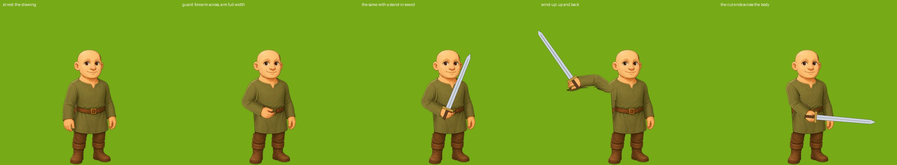
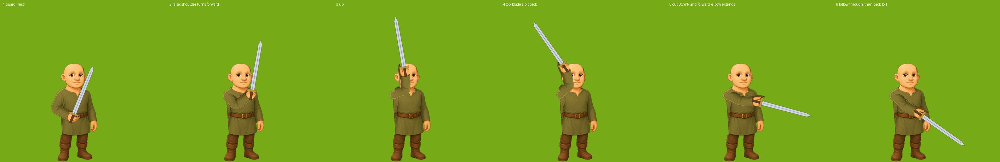

# Equipment plan: hand-held weapons first

Status: PROTOTYPE IN THE GAME, 2026-11-13 (plan v3). The long sword is wired in as a first look:
see "The prototype" just below for what is and is not built. Owner's brief: the equipped weapon in
the avatar's hand, swords held UP in an en garde stance (not hanging down like the Ogre's club), a
few weapon drawings per category on one standard footprint (tints and lengths make the variety;
weapon names may change to avoid one-offs), no two-handed animation yet, bows and arrows later,
armour and helmets as simple overlays later. This plan covers hand-held weapons. It builds on the
Ogre's club (docs/arm-rig-plan.md §0a) and is backlog item BL-23.

**v2 (owner, same day): the sword goes in the NEAR arm.** v1 put it in the arm on the side the
figure faces. That is the FAR arm of a three-quarter figure, half hidden behind the chest in every
outfit, and lifted it is a sliver (docs/art/equipment/probe-m-tunic.jpg). The owner ruled that a
deal-breaker: "it looks too unrealistic". The near arm is drawn whole and in front of the body, so
it is used instead; the sword crosses the body in front and the swing comes over and across it.

## The prototype (2026-11-13)

The owner asked to see the sword in the game before any more planning. What is in:

- **One drawing:** `game-client/public/assets/avatar/hand/weapon-long-sword.png` on the standard
  footprint (128x512, upright, grip at 64,448).
- **Weapon categories (owner 2026-11-13):** a weapon's row names its category in a `weaponClass`
  column, and the category owns the drawing in the hand, the guard and the swing
  (`heldWeapon.WEAPON_CLASSES`). One category exists, **sword** (the long sword, the guard above, the
  `slash` clip), on 17 rows: Short Sword, Long Sword, Great Sword, Sword of Song, Glowing Sword,
  Legendary Sword, Dragonslayer, Broadsword, Bastard Sword, Arming Sword, Falchion, and the region
  swords Portia's Rapier, Courtier's Rapier, Macbeth's Claymore, Bard's Blade, Messina Saber,
  Demonbane. A row may name its own drawing as `heldArt` (none does yet). The other ten melee
  weapons have no category and show nothing in the hand until theirs is built: axes (Giant Axe,
  Executioner's Axe), Halberd, Magic Halberd, War Hammer, Stone Maul, Knife, Mantuan Dagger, Fen
  Hook, Lethe Scythe. The two rapiers are swords for now and move when a thrust category exists.
- **Wired to the Combat panel's weapon slot:** what is in the hand comes from the equipped weapon
  (`player.settings.equippedWeapon`), which the panel changes on the tap. Unequip, or equip a weapon
  with no category, and the arm eases down and the plain drawing returns (rigshot `--away` shows it).
- **One rig a body, not one an outfit:** `avatar:male` (measured on the tunic) and `avatar:female`
  (measured on the adventurer) in `rigs.json`. Other outfits use their body's rig, so a wide sleeve
  may cut badly: that is the P2 outfit pass, not done.
- **Out only while an enemy is on the grid:** `PixiRenderer.js` also checks the grid's live NPC
  list (any `action: attack`). While a sword is equipped AND an enemy is there, `PixiRendererPCs.js`
  draws the avatar as its body with the near arm cut away plus an `ArmRig` holding the sword in the
  guard (`heldWeapon.js`); when the last enemy dies the arm eases down and the plain drawing returns.
- **The cut:** the `slash` clip (`armClips.js`), played by `CombatFX.playerSwing()` alongside the
  lunge in `Combat.js`. The player also turns to face the enemy struck.
- **The fist:** the drawn hand is open, so the arm is cut without it and a small fist in the hand's
  own colours is drawn round the grip (`ArmRig.handParts`).

Checked only on offline renders (`tools/art/rigshot.js --held`; the whole cut is
docs/art/equipment/prototype-slash.gif, at half speed). Not yet seen in a live fight. Things to
judge there: the blade crossing the face at the top of the raise, the fist, whether the cut lands
with the damage number, and how the other outfits' sleeves cut.

## 1. What exists today

- **The data is ready.** `settings.equippedWeapon` / `equippedShield` / `equippedArmor` are real
  slots (Combat panel, `combatGear.js`, mirrored by the server's `combatStats.js`); a weapon row has
  `hands` 1 or 2; `avatarLook.js` already reads `avatarHand` / `avatarTop` from the equipped rows and
  has a `hand` layer in `Z_ORDER`. No row names any art yet.
- **The weapons (44, all from the Warrior's Den):** 15 one-handed blades (knife, daggers, swords,
  rapiers, sabre, falchion, hook), 12 two-handed great blades, axes, hammers, a maul, a scythe and
  halberds, 5 spears and glaives, Darts, and 11 bows and crossbows (later). 32 melee weapons are in
  scope; Darts wait with the bows.
- **The rig is proven.** The Ogre has a three-joint arm (shoulder, elbow, wrist), a weapon that
  rides the wrist, the outline (`rim`) that keeps a lifted arm from looking cut out, an arm named as
  the attacking arm (`attackArm`), and `tools/art/rigshot.js` to see any pose with the client's own
  code.
- **The avatar is one composed picture per look** (face + outfit cloth + outfit skin + hair + hat),
  drawn on one base pose per body, turned a little to the viewer's right and mirrored for left. 14
  outfits today (7 a body).

## 2. The near arm works with the art we have

Tested, not guessed: the male tunic's NEAR arm (the image's left), cut by a rough temporary rig and
held in poses by the real arm code (`rigshot --pose`). No outfit art was redrawn; the sword is a
stand-in drawn over the frames to show where a blade would lie.

- **The arm is a whole arm in every pose.** Full width from shoulder to cuff, in front of the body:
  the thin-arm problem is gone.
- **At rest the figure is exactly the drawing.**
- **The torso behind the arm fills in.** The near arm hangs over the body's side, so lifting it
  uncovers a strip of tunic; the cut's fill (a copy of the tunic beside it) closed it, belt included.
  Patterned outfits (the King's embroidery, the peasant's apron) need the same check.
- **The hand is still an open, hanging hand.** That needs a fist (§3.1).

What this direction costs, said plainly:

- **The blade lies across the outfit**, from the belt up past the far shoulder. It hides part of the
  chest. The guard's angle is set so the blade passes beside the face, never over it.
- **The cut reaches less far.** The hand ends near the middle of the body, not out toward the
  target. The weapon's own length, the body's lean and the step the player already takes when
  striking make up for it.
- **One arm outline per outfit** (14 small data entries, each checked on a rigshot sheet), because a
  puffed sleeve, a bell sleeve and a fur mantle are not one shape. Tested on one outfit so far. The
  widest sleeves (the court gown's bell cuff, the robe) are the risk; the fallback for an outfit that
  will not cut cleanly is to redraw ONLY that outfit's near arm as its own piece.

## 3. The design

### 3.1 The weapon and the fist are their own pictures

The Ogre's club is painted into his arm; that cannot swap. For the avatar:

- **The weapon** is a separate sprite attached to the arm rig at the grip, fixed at a right angle
  to the forearm (§3.4).
- **The fist** is a small skin-tinted piece per body (two drawings). While a weapon is held the arm
  image ends at the wrist and the fist is drawn there, fingers over the handle. It takes the skin
  tone exactly as the face does.

Draw order: body, arm, weapon, fist. All of it is in front of the body, which is correct for the
near arm with no extra work. `ArmRig` gains the attachment (a child placed at the grip each frame,
turned by shoulder + elbow); the grip point and the mirroring already exist.

### 3.2 One standard weapon footprint, a few drawings

Every weapon is drawn the same way so any of them drops onto the hand:

- **Canvas:** 128 x 512 px (256 x 512 for a wide head), the weapon UPRIGHT, point up, on its centre
  line. **Grip point** fixed at (64, 448). A second grip at (64, 400) is marked now so a two-hand
  grip can come later without redrawing.
- **Scale:** the canvas is 1.2 tiles tall on the board. Length is in the art and in one row number
  (`handLength`, 0.8 to 1.2, stretching the blade only), so one drawing serves a short and a long
  version.
- **Two layers per drawing:** the metal (drawn in neutral steel, tinted per weapon: steel, bronze,
  dark iron, gold, a glowing blue) and the fittings (handle and guard, untinted). The same split the
  outfits use for cloth and skin.
- **Eight base drawings, one sheet:**

  | Base | Covers (today's names) |
  |---|---|
  | Dagger | Knife, Mantuan Dagger |
  | Short sword | Short Sword, Bard's Blade |
  | Long sword | Long Sword, Broadsword, Arming Sword, Sword of Song, Glowing Sword, Legendary Sword |
  | Rapier | Portia's Rapier, Courtier's Rapier |
  | Curved blade | Messina Saber, Falchion, Fen Hook |
  | Great sword | Great Sword, Macbeth's Claymore, Bastard Sword, Demonbane, Dragonslayer |
  | Axe or hammer head (wide) | Giant Axe, Executioner's Axe, War Hammer, Stone Maul |
  | Pole weapon | Spear, Magic Spear, Lakeside Spear, Boar Spear, Morrow Glaive, Halberd, Magic Halberd, Lethe Scythe |

  Names that would not match their drawing, to rename or accept: **Fen Hook** (a hook drawn as a
  curved sword), **Lethe Scythe** (a scythe drawn as a glaive), **War Hammer / Stone Maul** sharing
  the axe's shaft with a second head (so "axe or hammer" is really two heads on one drawing, nine
  drawings in all), **Halberd** on the spear's shaft. Darts wait for the ranged pass.
- **Row fields:** `avatarHand` (base drawing), `handTint`, `handLength`, `swing` (§3.4). `hands`
  exists. The same art, turned 45 degrees, replaces the emoji in the Combat panel and the shop.

### 3.3 The stance: en garde is a pose, not a drawing

A held pose of the rig (data): the near arm's elbow bent so the forearm lies across the body at belt
height, a little below level; the blade, at its right angle to the forearm, stands up and leans
toward the side the figure faces, passing the far shoulder. The pose holds while walking, with the walk's bob.

**The weapon is out only while there is an enemy on the grid** (owner 2026-11-13). Checked:

- on arriving on a grid (any enemy there: out);
- when an enemy dies (it was the last one: away);
- when an enemy appears (a Spawner makes one, a story moment adds one: out).

So it is away in Town and on the Homestead without a rule of its own, and away in a cleared valley
or dungeon. Out and away ease the arm between the drawing's hanging arm and the guard; the weapon
and the fist appear and go with it. "Enemy" is an NPC whose `action` is `attack` (Spawners do not
count until they make one). This replaces the avatar plan's older zone rule (out in the valley,
the dungeon and the FTUE opening).

### 3.4 The swing: raise, cut down and forward, reset

Three motions, all with the near arm (owner 2026-11-13, replacing v2's first idea of swinging the
arm back on its own side):

**The sword is rigid in the hand: always at a right angle to the forearm** (owner 2026-11-13). The
wrist does not turn, in the guard or anywhere in a swing, so where the blade points is decided by
the forearm alone: forearm level, blade upright; forearm tilted up, blade tipped back; forearm
hanging, blade level and pointing forward. (The rig's wrist joint stays, unused by the avatar.)

1. **Raise.** The elbow folds and the shoulder turns the upper arm part of the way forward
   (counter-clockwise on a figure facing right), lifting the forearm from just below level to
   tilted up, so the sword rises and at the top tips a little back. (Owner: with the shoulder doing
   the whole raise it pivoted too far and the joint looked wrong.)
2. **Cut down and forward.** The elbow straightens as the arm comes down in front, the hand
   reaching forward toward the target; the forearm swings down through level to hanging, so the
   blade comes over from tipped back, through upright, to level and pointing at the target.
3. **Reset** to the guard.

(Held poses of the test rig with a stand-in sword, not an animation yet. As shoulder and elbow
angles in radians: guard 0.15, -1.25; raise -0.4, -1.35; top -0.75, -1.35; cut -0.85, -0.2; down
-0.3, -0.1; end -0.05, -0.05. The blade's angle is the sum of the two plus a right angle. Two
things follow from the rigid grip, to judge in P1: at the top the blade stands in front of the
face for a moment, and the cut finishes with the arm low, because a level blade needs a hanging
forearm.)

Families, chosen by the weapon's `swing`, all on that pattern:

- **slash** (swords, curved blades, great swords): as above.
- **thrust** (rapiers, daggers, pole weapons): to be designed in P3. A blade at a right angle to
  the forearm cannot be driven point-first, so a thrust needs these weapons mounted in line with
  the forearm instead (a second fixed mounting angle, still with no wrist motion), or they simply
  use the slash.
- **chop** (axes, hammers): the same raise, higher and slower, the body leaning in.

A player's hit resolves on the tap (the combat rule), so each clip is short (under 300 ms) with the
blow early. The body's short step toward the target (`playerLunge`) stays and plays with the clip
for reach; unarmed is the lunge alone.

### 3.5 Which arm, mirrored

Every figure is drawn turned to the viewer's right, so the near arm is always the arm on the
image's LEFT: one rule for both bodies and every outfit (`attackArm: L`). The avatar already mirrors
to face the way it moves and fights, and the arm, weapon and fist mirror with it.

## 4. Two-handed weapons, and what waits

- **Two-handed weapons are not animated as two-handed** (owner: do not bite that off yet). They are
  held and swung in the one near hand like everything else; their drawing is longer and heavier and
  they use the slower clip. A true two-hand grip would need the far arm rigged as well, the thin arm
  this plan exists to avoid, so it stays out until there is a reason to solve that.
- **Shields** go on the far arm as a flat overlay that does not move (later).
- **Armour** is an outfit row, as the avatar plan decided, and gets a near-arm outline like any
  outfit. **Helmets** are hats. Both later.
- **Bows, crossbows and Darts:** the ranged pass, later.

## 5. Phases

| Phase | Scope | Done when |
|---|---|---|
| P0 | The probes (far arm rejected, near arm works) | Done |
| **P1 Prototype, outside the game** | Weapon attachment in `ArmRig`; the two fists; the guard pose; the `slash` clip; ONE long sword drawn on the standard footprint; near-arm outlines for one outfit a body (male tunic, female adventurer). All shown as rigshot animations | The owner approves the guard and the slash on both bodies |
| P2 In the game | `PixiRendererPCs` rigs the composed avatar; the `hand` layer feeds the attachment; combat plays the clip with the lunge; the weapon out only while an enemy is on the grid (§3.3); near-arm outlines for all 14 outfits, each checked on a rigshot sheet | Every outfit holds and swings the one sword cleanly, both bodies, both directions |
| P3 Weapon art | The sheet of base drawings, tints and lengths on the rows, `thrust` and `chop`, the renames, panel and shop icons from the same art | Every melee weapon shows in the hand and in the panels |
| P4 Later | Shields; bows and Darts; armour and helmet overlays; a two-hand grip only if wanted | |

P1 is the gate: it changes no game behaviour and settles the open questions (does the fist read,
does the blade sit well across the body, does the cut read as a cut) before any outfit work or
weapon sheet is commissioned.

## 6. Decisions for the owner

Settled 2026-11-13: the near arm; a few drawings per category with tints; renaming allowed; no
two-handed animation yet; the swing is raise, cut down and forward, reset; the weapon is out only
while an enemy is on the grid.

Still open:

1. **Wide sleeves:** if the court gown or the robe cannot be cut cleanly, redraw that outfit's near
   arm (recommended), or let those outfits keep the weapon lowered?
2. **Odd names:** rename Fen Hook and Lethe Scythe to match their drawings (recommended), or give
   each its own drawing?

## 7. Where things live

- Rig, clips, attachment: `game-client/src/Render/PixiRenderer/ArmRig.js`, `armClips.js`, `rigs.json`
  (a rig per body today; per outfit when one needs it), `heldWeapon.js` (footprint, guard, which arm).
- The look and its layers: `game-client/src/Avatar/avatarLook.js` (`equipFor`, `hand` in `Z_ORDER`),
  `avatarCompositor.js`; the board figure: `Render/PixiRenderer/PixiRendererPCs.js`.
- Combat: `GameFeatures/Combat/Combat.js`, `combatGear.js`, `Render/PixiRenderer/CombatFX.js`
  (`playerLunge`).
- Weapon rows: `game-server/tuning/resources.json` (category `power`, source Warrior's Den).
- Checking without the game: `node tools/art/rigshot.js` (`--pose s,e,w` holds a stance).
