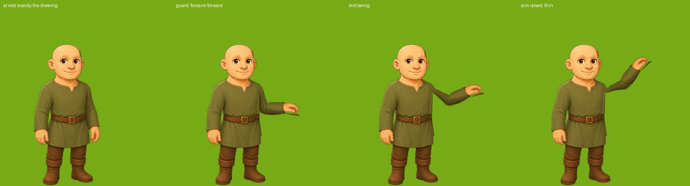

# Equipment plan: hand-held weapons first

Status: PLAN, 2026-11-13. Nothing in the game has changed. Owner's brief: the equipped weapon in
the avatar's hand, swords held UP in an en garde stance (not hanging down like the Ogre's club),
many swords of different lengths and art on one standard footprint, two-handed weapons if they can
be done at all, bows and arrows later, armour and helmets as simple overlays later. This plan covers
hand-held weapons. It builds on the Ogre's club (docs/arm-rig-plan.md §0a) and is backlog item BL-23.

## 1. What exists today

- **The data is ready.** `settings.equippedWeapon` / `equippedShield` / `equippedArmor` are real
  slots (Combat panel, `combatGear.js`, mirrored by the server's `combatStats.js`); a weapon row has
  `hands` 1 or 2; `avatarLook.js` already reads `avatarHand` / `avatarTop` from the equipped rows and
  has a `hand` layer in `Z_ORDER`. No row names any art yet.
- **The weapons (44, all from the Warrior's Den):**

  | Kind | One-handed | Two-handed |
  |---|---|---|
  | Blades (knife, daggers, swords, rapiers, sabre, falchion, hook) | 15 | 0 |
  | Great blades, axes, hammers, maul, scythe, halberds | 0 | 12 |
  | Spears and glaives | 2 | 3 |
  | Darts | 1 | 0 |
  | Bows and crossbows (LATER) | 0 | 11 |

  So 18 one-handed and 15 two-handed melee weapons are in scope; 26 of the 44 are two-handed, which
  is why §5 matters.
- **The rig is proven.** The Ogre has a three-joint arm (shoulder, elbow, wrist), a weapon that
  rides the wrist, the outline (`rim`) that keeps a lifted arm from looking cut out, the "facing arm"
  (`attackArm`), and `tools/art/rigshot.js` to see any pose with the client's own code.
- **The avatar is one composed picture per look** (face + outfit cloth + outfit skin + hair + hat),
  drawn on one base pose per body, turned a little to the viewer's right and mirrored for left. 14
  outfits today (7 a body).

## 2. Do we have to redo every arm? No

I tested it instead of guessing: the male tunic's facing arm, cut by a rough temporary rig and held
in four poses by the real arm code (`rigshot --pose`). Nothing was redrawn.

What it shows:

- **It works with the art we have.** At rest the figure is exactly the drawing. The forearm lifts
  into a guard and the arm raises for a swing with no hole in the tunic.
- **The lifted arm is thin.** The facing arm is the FAR arm of a three-quarter figure, so the outfit
  draws its upper half as a sliver tucked behind the chest. Forearm and hand are full width.
- **The hand is an open, hanging hand.** Turned level it reads as a pointing hand, not a grip.

Neither needs new outfit art:

1. **A fist per body** (two small skin-tinted pieces): while a weapon is held, the arm image is cut
   off at the wrist and the fist is drawn there, fingers over the hilt. The fist takes the skin tone
   exactly as the face does.
2. **Thicken the arm as it lifts** (the rig's existing `bulge`, given a longer reach): at rest
   nothing changes; as the arm leaves the body it swells to a full arm's width.
3. **A guard that leans on the elbow.** En garde keeps the upper arm near the body, where the sliver
   is hidden as drawn, and raises only the forearm, which is full width. The swings are written the
   same way: mostly elbow and wrist, a modest shoulder, the body's lean doing the rest.

What it does cost: **one arm outline per outfit** (14 small data entries, each checked with a
rigshot sheet), because a puffed sleeve, a bell sleeve and a fur mantle are not the same shape. The
risky ones are the widest sleeves (the court gown's bell cuff, the robe, the peasant's puff). The
fallback for an outfit whose sleeve cannot be cut cleanly is to redraw ONLY that outfit's facing arm
as its own piece; the plan assumes at most two or three of those, not fourteen.

## 3. The design

### 3.1 The weapon is its own picture on the hand

The Ogre's club is painted into his arm; that cannot swap. For the avatar the weapon is a separate
sprite attached to the arm rig at the grip, turning with the wrist joint. Draw order on the arm:
arm, then weapon, then fist. `ArmRig` gains an attachment (a child sprite placed at the grip each
frame, rotated by shoulder + elbow + wrist); the wrist joint, the grip point and the mirroring are
already there.

### 3.2 One standard weapon footprint

Every weapon is drawn the same way so any of them drops onto any hand:

- **Canvas:** 128 x 512 px, the weapon standing UPRIGHT, point up, pommel down, on its centre line.
- **Grip point:** fixed at (64, 448): the middle of the handle. This is where the fist sits.
- **Scale:** the canvas is 1.6 tiles tall on the board for every weapon, so length is in the art:
  a dagger fills about a third of the canvas above the grip, a short sword half, a long sword two
  thirds, a great sword all of it. Nothing is scaled per weapon in code.
- **Wide heads** (axes, hammers, the scythe) use a 256 x 512 canvas with the same grip point and
  centre line.
- **Second grip** for two-handed weapons: fixed at (64, 400), a hand's width above the first.
- **Art:** drawn in sheets of eight on a guide with those marks (the doober pipeline: one image
  makes eight weapons), cut by the existing sheet splitter. About five sheets for all 33 melee
  weapons. The same art, turned 45 degrees, replaces the emoji in the Combat panel and the shop.
- **Row fields:** `avatarHand` (the file), `swing` (which clip family, §3.4); `hands` exists.

### 3.3 The stance: en garde is a pose, not a drawing

The guard is a held pose of the rig (data): upper arm a little out, forearm raised forward toward
the side the figure faces, wrist turned so the blade stands up and slightly forward. It eases in
when a weapon comes out and out when it is put away. Shown where the avatar plan already decided
(valley, dungeon, the FTUE opening); put away in Town and on the Homestead. While walking the pose
holds, with the walk's bob.

### 3.4 Swings

Clips by family, chosen by the weapon's `swing`:

- **slash** (swords, sabre, falchion, hook): blade back over the shoulder, down across the target.
- **thrust** (rapiers, daggers, knife, one-handed spears): forearm back, straight out.
- **chop** (axes, hammers, maul, great blades): higher and slower, the body leaning in.

A player's hit resolves on the tap (the combat rule), so each clip is short (under 300 ms) with the
blow early, and replaces today's `playerLunge` for an armed player. Unarmed keeps the lunge.

### 3.5 The facing arm

The avatar already mirrors to face the way it moves and fights, and every figure is drawn turned to
the viewer's right, so the facing arm is always the arm on the image's right: one rule for both
bodies and every outfit. (The Ogre's lesson: the weapon hand and the figure's facing must agree in
the drawing.)

## 4. What stays simple overlays (later, not this plan)

- **Armour** is an outfit row, as the avatar plan decided: it replaces the chosen outfit and goes
  through the same body pipeline, so it gets an arm outline like any outfit.
- **Helmets** are hats (the `hat` slot).
- **Shields** are a flat overlay on the other arm, which does not move.

## 5. Two-handed weapons

Not possible with what exists today, but not impossible. A true two-hand grip needs two things the
rig does not have: the OTHER arm rigged as well (the near arm, reaching across the chest), and that
hand kept on the weapon while it moves, which is inverse kinematics (solve the off arm's two joints
so its hand lands on the weapon's second grip point each frame). Both are known techniques and the
skinned arm suits them. The risks are the near arm crossing over the outfit's chest detail, and
fourteen more arm outlines.

Three ways to treat the 15 two-handed melee weapons:

| Option | What the player sees | Cost |
|---|---|---|
| **A. One-hand carry (recommended first)** | The great sword or axe held in the facing hand like any weapon, but its art is longer and heavier and it uses the slower `chop`. The off hand hangs. | None beyond §3 |
| B. True two-hand grip | Both hands on the handle in guard and through the swing | Second arm rig per outfit, off-hand IK, new guard and clips |
| C. Shouldered | Resting on the shoulder at rest, swung one-handed | A second rest pose; reads oddly for polearms |

Recommendation: ship A with the one-handed weapons, then judge whether B is worth it once a great
sword is on screen. Because the weapon footprint already carries a second grip point, B can be
added later without redrawing any weapon.

## 6. Phases

| Phase | Scope | Done when |
|---|---|---|
| P0 | The probe in §2 | Done |
| **P1 Prototype, outside the game** | Weapon attachment in `ArmRig`; the two fists; the guard pose; the `slash` clip; ONE sword drawn on the standard footprint; arm outlines for one outfit a body (male tunic, female adventurer). All seen in rigshot animations | The owner approves the guard and the slash on both bodies |
| P2 In the game | `PixiRendererPCs` rigs the composed avatar; the `hand` layer feeds the attachment; combat plays the clip in place of the lunge; the zone rule (out in the valley, away in Town); arm outlines for all 14 outfits, each checked on a rigshot sheet | Every outfit holds and swings the one sword cleanly, both bodies, both directions |
| P3 Weapon art | The 18 one-handed weapons, then the 15 two-handed ones as option A; `thrust` and `chop`; the panel and shop icons from the same art | Every melee weapon shows in the hand and in the panels |
| P4 Later | True two-hand grip (option B) if wanted; shields; then bows and arrows | |

P1 is the gate: it changes no game behaviour and answers the two open questions (does the thickened
arm look like an arm, does the fist read) before any outfit work or weapon art is commissioned.

## 7. Decisions for the owner

1. **Two-handed weapons:** option A first (recommended), or hold them until B exists?
2. **The guard:** always held while a weapon is out (recommended, simplest), or raised only when an
   enemy is near?
3. **Wide sleeves:** if the court gown or the robe cannot be cut cleanly, redraw that outfit's arm
   (recommended), or let those outfits keep the weapon lowered?
4. **Weapon art count:** all 33 melee weapons their own art (five sheets), or one drawing per
   family recoloured by tier to start (two sheets)?

## 8. Where things live

- Rig, clips, attachment: `game-client/src/Render/PixiRenderer/ArmRig.js`, `armClips.js`, `rigs.json`
  (a rig per body and outfit; docs/arm-rig-plan.md §4 expected one per body, the probe says per outfit).
- The look and its layers: `game-client/src/Avatar/avatarLook.js` (`equipFor`, `hand` in `Z_ORDER`),
  `avatarCompositor.js`; the board figure: `Render/PixiRenderer/PixiRendererPCs.js`.
- Combat: `GameFeatures/Combat/Combat.js`, `combatGear.js`, `Render/PixiRenderer/CombatFX.js`
  (`playerLunge`).
- Weapon rows: `game-server/tuning/resources.json` (category `power`, source Warrior's Den).
- Checking without the game: `node tools/art/rigshot.js` (`--pose s,e,w` holds a stance).
